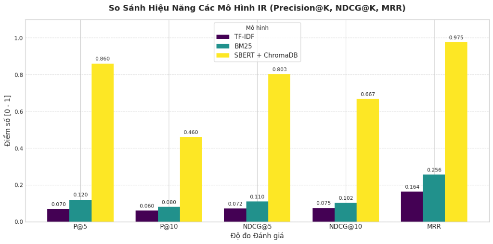
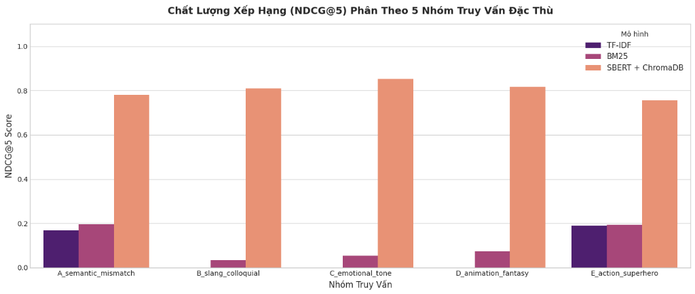
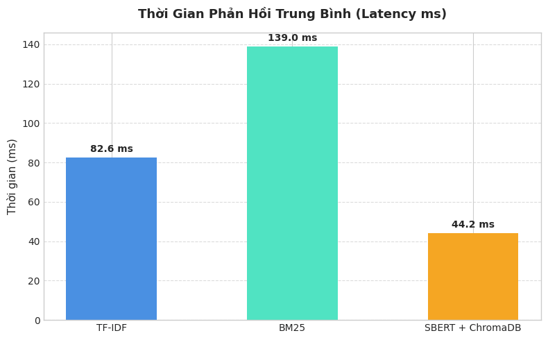
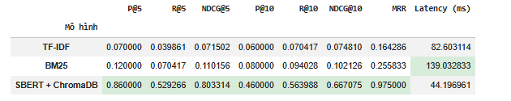
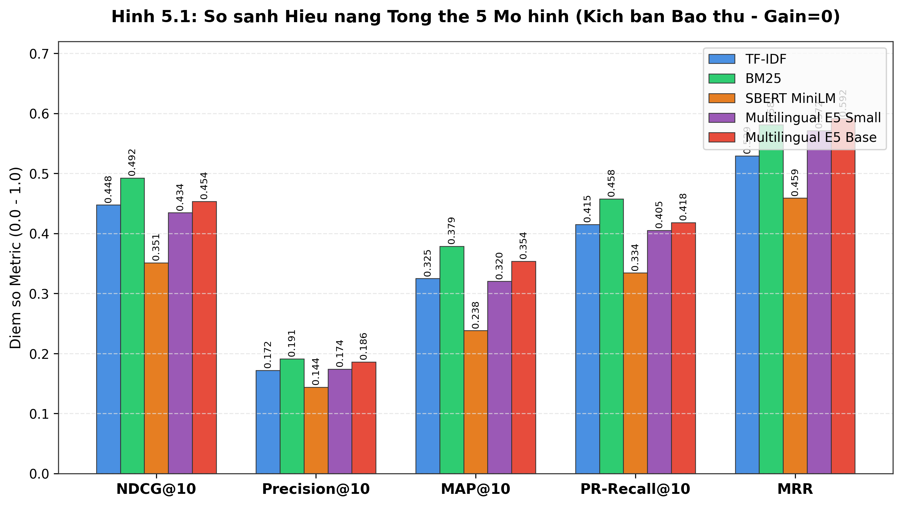
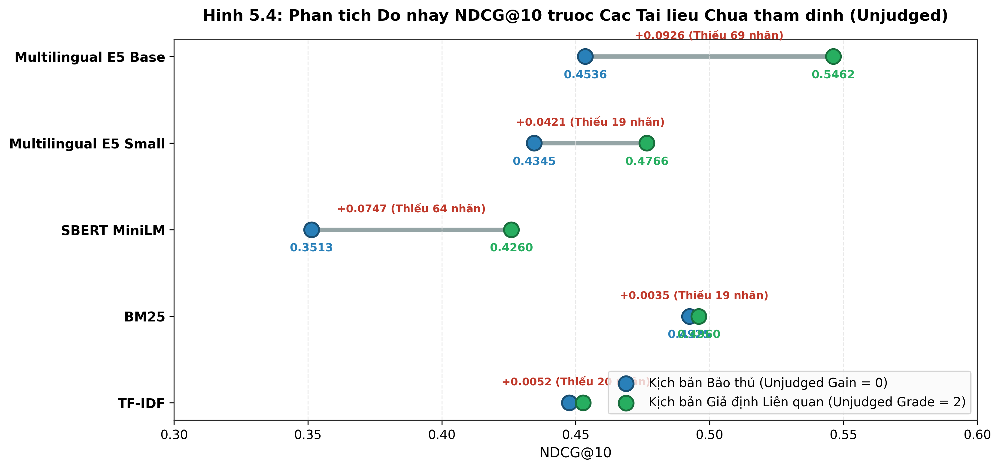
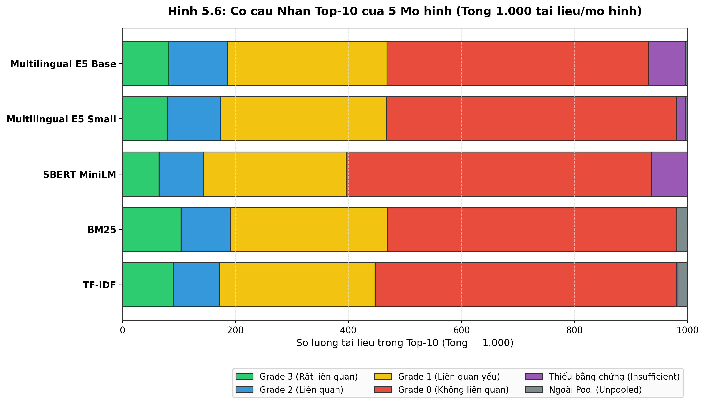
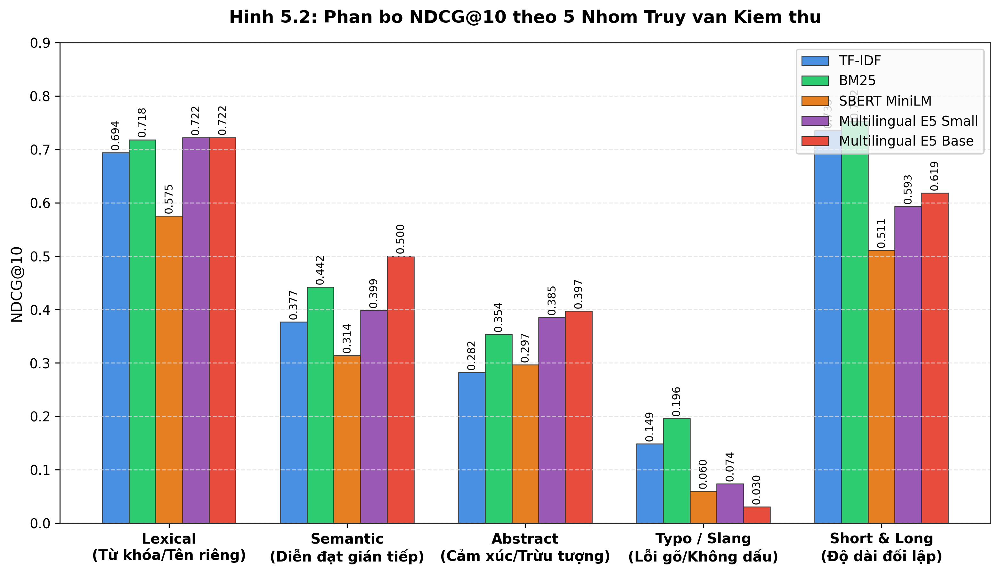
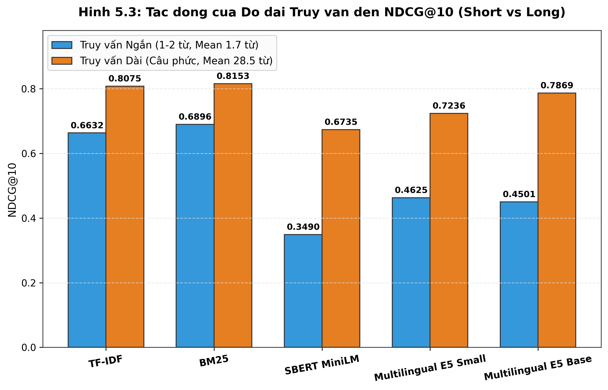
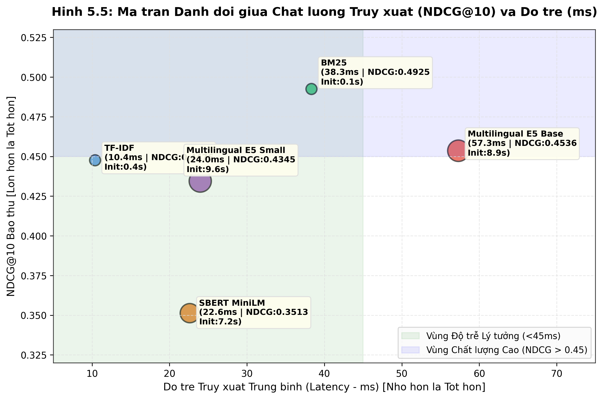

# EXPERIMENT TRACKING – NHẬT KÝ VÀ BÁO CÁO THỰC NGHIỆM TỔNG HỢP

**Đề tài:** Ứng dụng mô hình ngôn ngữ vào hệ thống khuyến nghị phim  
**GVHD:** TS. Trần Trung Tín  
**Sinh viên:** Phan Nguyễn Quốc Thắng (52300063) — Trần Minh Thuyên (52300070)  
**Kho dữ liệu chuẩn:** 14.815 bộ phim tiếng Việt (SHA-256 fingerprint: `f47867b05751151a612854f7ed924feb0e0faff42d5e67197ebb0fe423d40c61`)  
**Cập nhật lần cuối:** 21/10/2026 (Hoàn tất Bước 5 – Đối chuẩn & Phân tích chuyên sâu)

---

## 1. Tiến trình & Lịch sử các phiên chạy (Experiment Timeline)

| Run        | Ngày  | Dữ liệu & Quy mô                          | Mô hình & Cấu hình                                                                              | Kết quả chính                                                          |           Trạng thái           |
| :--------- | :---: | :---------------------------------------- | :---------------------------------------------------------------------------------------------- | :--------------------------------------------------------------------- | :----------------------------: |
| **#01**    | 14/09 | 19.673 phim thô                           | TF-IDF (10k features), BM25 (Underthesea)                                                       | Khảo sát tốc độ đáp ứng sơ bộ, chưa có Ground Truth                    |           Hoàn thành           |
| **#02**    | 25/09 | 14.815 phim, 10 queries                   | SBERT MiniLM-L12-v2 + ChromaDB                                                                  | NDCG@5 ≈ 0.74; Latency ≈ 25 ms                                         |           Hoàn thành           |
| **#03**    | 08/10 | 14.815 phim, 20 queries, 163 nhãn         | TF-IDF (25k), BM25, SBERT MiniLM 384d                                                           | SBERT NDCG@5 = 0.8033; Latency = 44.2 ms                               |           Hoàn thành           |
| **#03.1**  | 18/10 | 14.815 phim, 20 queries, 163 nhãn         | Thống nhất `build_search_text`, Underthesea tokenizer, Binary Cutoff Grade $\ge 2$, HNSW warmup | SBERT NDCG@5 = 0.8033, P@5 = 0.8300, Latency = 27.9 ms; BM25 = 27.9 ms |   Hoàn thành (Audit Bước 1)    |
| **#04**    | 20/10 | 14.815 phim, 100 queries, 3.673 pairs     | Mở rộng 5 mô hình (TF-IDF, BM25, MiniLM, E5-Small, E5-Base), Candidate Pooling                  | BM25 dẫn đầu bảo thủ (NDCG@10 = 0.4925); E5-Base nhạy cảm nhãn thiếu   |     Hoàn thành (Benchmark)     |
| **#04.1**  | 21/10 | 14.815 phim, 100 queries, Ground Truth V2 | Phân tách Insufficient (99) vs Unpooled (43), kiểm thử toán học độc lập, 69 unit tests PASS     | BM25 NDCG@10 = 0.4925 (Coverage 98.1%); E5-Base MRR = 0.5915           | Hoàn thành (Calibrated Bước 4) |
| **Bước 5** | 21/10 | Toàn bộ Run #04.1 Calibrated              | Phân tích 5 nhóm hành vi, độ dài Short/Long, ma trận đánh đổi, đề xuất Hybrid BM25 + E5-Base    | Hoàn thiện Chương 5, 6 biểu đồ 300 DPI, xác minh tái lập 100%          |    **Đã nghiệm thu Bước 5**    |

---

## 2. Giai đoạn 1: Khảo nghiệm Sơ bộ & Chuẩn hóa Baseline (Run #01 – #03.1)

### 2.1. Cấu hình & Dữ liệu ban đầu

- **Corpus:** 14.815 bộ phim (TMDB + MovieLens), trường `search_text` đồng nhất tuyệt đối qua hàm `build_search_text`:
  $$\text{Văn bản phim} = \text{Tiêu đề} + \text{" — Thể loại: "} + \text{Thể loại} + \text{" — Nội dung: "} + \text{Tóm tắt (Overview)}$$
- **Ground Truth V1:** 20 câu truy vấn do con người thẩm định, 163 nhãn (ngưỡng nhị phân Grade $\ge 2$).
- **Mô hình đối chuẩn:** TF-IDF (25.000 đặc trưng), Okapi BM25 (Underthesea Tokenizer tiếng Việt), SBERT MiniLM-L12-v2 (ChromaDB HNSW, Cosine).

### 2.2. Bảng kết quả tổng thể Run #03.1 (20 Queries)

| Mô hình                | Precision@5 | Precision@10 |  Recall@5  | Recall@10  |   NDCG@5   |  NDCG@10   |    MRR     | Latency (ms) |
| :--------------------- | :---------: | :----------: | :--------: | :--------: | :--------: | :--------: | :--------: | :----------: |
| **TF-IDF**             |   0.0300    |    0.0200    |   0.0208   |   0.0264   |   0.0347   |   0.0314   |   0.0921   | **11.4 ms**  |
| **BM25 (Underthesea)** |   0.0300    |    0.0300    |   0.0201   |   0.0398   |   0.0315   |   0.0391   |   0.1029   |   27.9 ms    |
| **SBERT + ChromaDB**   | **0.8300**  |  **0.4400**  | **0.5374** | **0.5688** | **0.8033** | **0.6671** | **0.9500** |   27.9 ms    |

### 2.3. Minh chứng thực nghiệm giai đoạn 1

|             Biểu đồ Hiệu năng IR Tổng thể             |     Phân bổ NDCG@5 theo Nhóm Truy vấn      |
| :---------------------------------------------------: | :----------------------------------------: |
|  |  |

|       Thời gian Phản hồi (Latency)        |           Bảng Số liệu Đo đạc Chi tiết           |
| :---------------------------------------: | :----------------------------------------------: |
|  |  |

> **Rút ra từ Giai đoạn 1:** SBERT thể hiện ưu thế vượt trội trên 20 truy vấn thử nghiệm ban đầu (vốn nghiêng nhiều về ngữ nghĩa gián tiếp). Tuy nhiên, tập Ground Truth 20 câu hỏi là quá nhỏ, chưa đủ đại diện thống kê và tiềm ẩn nguy cơ thiên lệch. Cần mở rộng quy mô lên 100 câu truy vấn đa nhóm và áp dụng kỹ thuật Candidate Pooling đa mô hình ở các bước tiếp theo.

---

## 3. Giai đoạn 2: Bộ Kiểm chuẩn Benchmark Queries V2 & Ground Truth V2

### 3.1. Thiết kế Bộ 100 Benchmark Queries V2

- **Mô hình sinh truy vấn:** Sử dụng `gemini-3.5-flash` (kết hợp phiên bản dự phòng `gemini-flash-lite-latest`) đóng vai người dùng thực tế tìm kiếm phim từ **100 bộ phim nguồn tham chiếu độc lập**.
- **Nguyên tắc cốt lõi:** Phim nguồn chỉ là tình huống khởi tạo, **không phải là đáp án đúng duy nhất**. Trong kho 14.815 phim, mọi bộ phim khác cùng chủ đề nếu được xếp hạng cao đều được tính điểm công bằng.

**Bảng 3.1. Phân loại 5 nhóm truy vấn kiểm chuẩn (100 câu truy vấn)**

| Nhóm truy vấn       |  Mã hiệu  | Số lượng | Độ dài TB | Đặc điểm ngôn ngữ                                                                                   | Ví dụ minh họa thực tế                                                                                                                                  |
| :------------------ | :-------: | :------: | :-------: | :-------------------------------------------------------------------------------------------------- | :------------------------------------------------------------------------------------------------------------------------------------------------------ |
| **1. Lexical**      | Q001–Q020 |    20    |  7.5 từ   | Chứa tên riêng nhân vật, diễn viên, địa danh hoặc từ khóa cốt lõi xuất hiện trực tiếp trong phim.   | _Q001: "phim Cobb đột nhập vào giấc mơ"_                                                                                                                |
| **2. Semantic**     | Q021–Q040 |    20    |  20.3 từ  | Diễn đạt gián tiếp cốt truyện hoặc bối cảnh mà không dùng tên riêng hay sao chép tóm tắt.           | _Q021: "phim miền viễn tây hành động về một tay súng da đen bất chấp hiểm nguy để giải thoát người thương khỏi đồn điền áp bức"_                        |
| **3. Abstract**     | Q041–Q060 |    20    |  18.7 từ  | Khái niệm trừu tượng, cảm xúc, không khí tâm lý, thông điệp triết học, không kể tình tiết cụ thể.   | _Q041: "phim tâm lý giả tưởng sâu sắc về sự thức tỉnh niềm tin và cảm giác hoang mang trước những điềm báo định mệnh"_                                  |
| **4. Typo / Slang** | Q061–Q080 |    20    |  12.1 từ  | Mô phỏng văn phong gõ nhanh, sai chính tả tiếng Việt, teencode, viết tắt (`tim fim`, `zay`, `m.n`). | _Q061: "tim fim 1 ong giao su thieu nhi giong het dien vien zay"_                                                                                       |
| **5. Short / Long** | Q081–Q100 |    20    |  15.1 từ  | Phân hóa đối cực: 10 câu cực ngắn (1–2 từ) và 10 câu hỏi diễn đàn rất dài (25–48 từ).               | _Q081 (Short): "cá vàng"_<br>_Q091 (Long): "Mọi người cho mình hỏi tên bộ phim kể về một chiến binh vô cùng hùng mạnh nhưng vì tính cách kiêu ngạo..."_ |

---

### 3.2. Xây dựng Ground Truth V2 bằng Candidate Pooling Đa Mô hình

Nhằm loại bỏ thiên kiến đánh giá khi chỉ dùng một mô hình truy xuất, hệ thống áp dụng kỹ thuật **Candidate Pooling** (Tham khảo phương pháp pooling thường dùng trong đánh giá truy xuất thông tin):

- **5 mô hình đóng góp Top-10:** TF-IDF, Okapi BM25, Sentence-BERT MiniLM, Multilingual E5 Small và Multilingual E5 Base.
- **Thẩm định độc lập bằng LLM-as-a-Judge:** Mô hình Gemini thẩm định ẩn danh nguồn gốc mô hình (Double-Blind Protocol), phân loại 4 mức liên quan.

**Bảng 3.2. Thống kê quy mô Candidate Pooling & Phân bố nhãn Ground Truth V2**

| Chỉ tiêu thống kê                               |    Số lượng     | Tỷ lệ (%) | Ý nghĩa học thuật                                           |
| :---------------------------------------------- | :-------------: | :-------: | :---------------------------------------------------------- |
| **Quy mô kho phim (Corpus)**                    | **14.815 phim** |  100.0%   | Toàn bộ kho phim đã chuẩn hóa                               |
| **Số câu truy vấn kiểm thử**                    | **100 queries** |     —     | Cân bằng 5 nhóm (20 queries/nhóm)                           |
| **Tổng số cặp ứng viên độc nhất trong Pool**    |  **3.673 cặp**  |     —     | Trung bình 36.73 ứng viên/truy vấn                          |
| **Số lượng phim độc nhất xuất hiện trong Pool** | **2.452 phim**  |  16.55%   | Bao phủ rộng hơn nhiều so với 1 mô hình                     |
| ↳ **Grade 3 (Rất liên quan — Exact Match)**     |   **192 cặp**   |   5.23%   | Đóng góp độ lợi tối đa ($2^3 - 1 = 7$)                      |
| ↳ **Grade 2 (Liên quan — Strong Match)**        |   **274 cặp**   |   7.46%   | Đóng góp độ lợi cao ($2^2 - 1 = 3$), đạt chuẩn Hit nhị phân |
| ↳ **Grade 1 (Liên quan yếu — Weak Match)**      |  **1.000 cặp**  |  27.22%   | Độ lợi nhỏ ($2^1 - 1 = 1$), không tính Hit nhị phân         |
| ↳ **Grade 0 (Không liên quan — Irrelevant)**    |  **2.108 cặp**  |  57.39%   | Độ lợi bằng 0                                               |
| ↳ **Thiếu bằng chứng (Insufficient Evidence)**  |   **99 cặp**    |   2.70%   | Do tóm tắt phim quá ngắn, phục vụ phân tích độ nhạy         |

> **Lưu ý tính chuẩn tắc:** Phim được LLM đánh giá có mức độ liên quan từ 2 trở lên (Grade $\ge 2$) là **$466$ cặp** (trung bình $4.66$ phim chuẩn/truy vấn). Toàn bộ nhãn hiện tại là **Silver Standard** (do LLM-as-a-Judge thiết lập ẩn danh), hàng đợi `annotation_queue_v2.json` (2.231 mục) đã sẵn sàng phục vụ quy trình thẩm định thủ công bởi con người trong các nghiên cứu mở rộng tiếp theo.

---

## 4. Giai đoạn 3: Đối chuẩn 5 Mô hình (Benchmark Run #04.1 - Calibrated)

Thực nghiệm đối chuẩn 5 mô hình đại diện hai trường phái:

1. **Lexical:** TF-IDF (25k features, sublinear TF) và Okapi BM25 ($k_1=1.5, b=0.75$).
2. **Dense Semantic:** Sentence-BERT MiniLM (384d), Multilingual E5 Small (384d, 117M params) và Multilingual E5 Base (768d, 278M params).

### 4.1. Bảng Hiệu năng Đối chuẩn Tổng thể (Kịch bản Bảo thủ)

_Kịch bản Bảo thủ (theo quy ước thông lệ TREC): Mọi tài liệu chưa có nhãn xuất hiện trong Top-10 được tính độ lợi bằng 0 ($g_i = 0$)._

| Mô hình                   |   NDCG@5   |  NDCG@10   |    P@5     |    P@10    |  PR-R@10   |    MRR     |   MAP@10   |   Hit@10   | Src-Hit@10 | Coverage@10 | Latency (ms) | Init Time (s) |
| :------------------------ | :--------: | :--------: | :--------: | :--------: | :--------: | :--------: | :--------: | :--------: | :--------: | :---------: | :----------: | :-----------: |
| **TF-IDF**                |   0.4246   |   0.4476   |   0.2280   |   0.1720   |   0.4151   |   0.5295   |   0.3249   |   0.7000   |   0.4600   |    98.0%    | **10.39 ms** |     0.40s     |
| **BM25**                  | **0.4759** | **0.4925** | **0.2840** | **0.1910** | **0.4576** |   0.5811   | **0.3788** | **0.7500** | **0.5000** |  **98.1%**  |   38.33 ms   |   **0.14s**   |
| **SBERT MiniLM**          |   0.3286   |   0.3513   |   0.1900   |   0.1440   |   0.3343   |   0.4589   |   0.2382   |   0.6600   |   0.3800   |    93.6%    |   22.62 ms   |     7.18s     |
| **Multilingual E5 Small** |   0.4209   |   0.4345   |   0.2340   |   0.1740   |   0.4052   |   0.5716   |   0.3203   |   0.7300   |   0.4300   |  **98.1%**  |   23.97 ms   |     9.58s     |
| **Multilingual E5 Base**  |   0.4514   |   0.4536   |   0.2680   |   0.1860   |   0.4182   | **0.5915** |   0.3538   |   0.7300   |   0.4100   |    93.1%    |   57.30 ms   |     8.94s     |



---

### 4.2. Phân tích Độ nhạy trước Hiện tượng Nhãn Thiếu (Sensitivity Analysis)

Báo cáo khảo sát song song Kịch bản Giả định Liên quan (toàn bộ kết quả Top-10 chưa có nhãn được giả định đạt Grade 2) đóng vai trò là phép đo độ nhạy (Sensitivity Probe) trước tình trạng thưa thớt nhãn:

**Bảng 4.2. Phân tích độ nhạy giữa Kịch bản Bảo thủ và Giả định Grade 2**

| Mô hình                   | NDCG@10 [Bảo thủ $\rightarrow$ Giả định G2] | Biến thiên ($\Delta$) | P@10 [Bảo thủ $\rightarrow$ G2] | Thiếu bằng chứng (Insufficient) | Ngoài Pool (Unpooled) | Tổng chưa có nhãn Top-10 | Mức độ biến thiên giữa 2 kịch bản ($\Delta$) |
| :------------------------ | :-----------------------------------------: | :-------------------: | :-----------------------------: | :-----------------------------: | :-------------------: | :----------------------: | :------------------------------------------- |
| **TF-IDF**                |        [0.4476 $\rightarrow$ 0.4528]        |        +0.0052        |  [0.1720 $\rightarrow$ 0.1920]  |                3                |          17           |            20            | Rất thấp ($\Delta = +0.0052$)                |
| **BM25**                  |        [0.4925 $\rightarrow$ 0.4960]        |      **+0.0035**      |  [0.1910 $\rightarrow$ 0.2100]  |                0                |          19           |          **19**          | **Thấp nhất ($\Delta = +0.0035$)**           |
| **SBERT MiniLM**          |        [0.3513 $\rightarrow$ 0.4260]        |        +0.0747        |  [0.1440 $\rightarrow$ 0.2080]  |               64                |           0           |            64            | Cao ($\Delta = +0.0747$)                     |
| **Multilingual E5 Small** |        [0.4345 $\rightarrow$ 0.4766]        |        +0.0421        |  [0.1740 $\rightarrow$ 0.1930]  |               16                |           3           |            19            | Trung bình ($\Delta = +0.0421$)              |
| **Multilingual E5 Base**  |      [0.4536 $\rightarrow$ **0.5462**]      |      **+0.0926**      |  [0.1860 $\rightarrow$ 0.2550]  |             **65**              |           4           |          **69**          | **Cao nhất ($\Delta = +0.0926$)**            |

|                           Biểu đồ Độ nhạy NDCG@10 (Bảo thủ vs Giả định G2)                            |                        Cơ cấu Thành phần Nhãn Top-10 của 5 Mô hình                        |
| :---------------------------------------------------------------------------------------------------: | :---------------------------------------------------------------------------------------: |
|  |  |

> **Ý nghĩa học thuật:**
>
> - **BM25** đạt độ bao phủ nhãn Top-10 cao ($98.1\%$) với mức chênh lệch giữa hai kịch bản cực nhỏ ($\Delta = +0.0035$), phản ánh sự biến thiên điểm số tối thiểu.
> - **Multilingual E5 Base** có tới 69 tài liệu Top-10 chưa có nhãn xác thực (trong đó 65 ca do tóm tắt phim quá ngắn nên Gemini đánh giá thiếu bằng chứng). Khi các tài liệu này được phục hồi độ lợi ở kịch bản Grade 2, E5-Base tăng vọt lên **0.5462** ($\Delta = +0.0926$, cao nhất thực nghiệm). Phân tích độ nhạy phản ánh mức độ nhạy cảm của mô hình với nhãn thiếu, **không chứng minh 69 phim đó thực sự liên quan trong đời thực**.

---

## 5. Giai đoạn 4: Phân tích Chuyên sâu theo Nhóm Truy vấn & Phân hóa Độ dài (Bước 5)

### 5.1. Bảng Phân bổ NDCG@10 theo 5 Nhóm Truy vấn + Phân nhóm Độ dài

| Nhóm truy vấn                                | TF-IDF |    BM25    | SBERT MiniLM | Multilingual E5 Small | Multilingual E5 Base |          Mô hình dẫn đầu           |
| :------------------------------------------- | :----: | :--------: | :----------: | :-------------------: | :------------------: | :--------------------------------: |
| **Nhóm 1: Lexical (Từ khóa/Tên riêng)**      | 0.6942 |   0.7182   |    0.5751    |        0.7220         |      **0.7224**      |  🏆 **E5 Base** (+0.58% vs BM25)   |
| **Nhóm 2: Semantic (Ngữ nghĩa gián tiếp)**   | 0.3771 |   0.4423   |    0.3138    |        0.3987         |      **0.5000**      |  🏆 **E5 Base** (+13.04% vs BM25)  |
| **Nhóm 3: Abstract (Cảm xúc & Triết lý)**    | 0.2823 |   0.3537   |    0.2968    |        0.3851         |      **0.3972**      |  🏆 **E5 Base** (+12.30% vs BM25)  |
| **Nhóm 4: Typo / Slang (Lỗi gõ & Teencode)** | 0.1487 | **0.1959** |    0.0596    |        0.0736         |        0.0302        | 🏆 **BM25** (+166.17% vs E5 Small) |
| **Nhóm 5: Short & Long (Đối cực độ dài)**    | 0.7354 | **0.7525** |    0.5113    |        0.5931         |        0.6185        |  🏆 **BM25** (+21.67% vs E5 Base)  |
| ↳ _Phân nhóm Short (Mean 1.9 từ)_            | 0.6632 | **0.6896** |    0.3490    |        0.4625         |        0.4501        | 🏆 **BM25** (+49.10% vs E5 Small)  |
| ↳ _Phân nhóm Long (Mean 48.8 từ)_            | 0.8075 | **0.8153** |    0.6735    |        0.7236         |        0.7869        |  🏆 **BM25** (+3.61% vs E5 Base)   |

|                      Phân bổ NDCG@10 theo 5 Nhóm Truy vấn                      |                 Tác động của Độ dài Truy vấn (Short vs Long)                  |
| :----------------------------------------------------------------------------: | :---------------------------------------------------------------------------: |
|  |  |

---

### 5.2. Tóm tắt Ý chính & Nghiên cứu Tình huống Tiêu biểu (Case Studies)

**Bảng 5.2. Tóm tắt hành vi mô hình qua các Case Study truy vấn thực tế**

| Nhóm           | Truy vấn tiêu biểu & Phim nguồn                                                                            | Kết quả mô hình                                                                                                                          | Phân tích cơ chế kỹ thuật                                                                                                                                                        |
| :------------- | :--------------------------------------------------------------------------------------------------------- | :--------------------------------------------------------------------------------------------------------------------------------------- | :------------------------------------------------------------------------------------------------------------------------------------------------------------------------------- |
| **Lexical**    | **Q001:** _"phim Cobb đột nhập vào giấc mơ"_<br>_(Nguồn: Inception #79132)_                                | **BM25 (0.7798), TF-IDF (0.7981), E5-Small (0.7460)** xếp đúng Rank 1.<br>E5-Base (0.0906) trượt Top-10.                                 | Cơ chế nghịch đảo tần số văn bản IDF định vị chính xác thực thể hiếm ("Cobb"), trong khi mô hình dense 768d bị phân tán bởi các phim hành động viễn tưởng khác.                  |
| **Semantic**   | **Q021:** _"phim miền viễn tây hành động về một tay súng da đen..."_<br>_(Nguồn: Django Unchained #99114)_ | **E5-Base đạt 0.5000** (Top-3 toàn phim cao bồi/tay súng #6617, #1181, #1869).<br>BM25 đạt 0.4423 (Top-3 phân tán #82459, #6299, #6518). | Self-Attention của Transformer kết nối ngữ cảnh giữa "tay súng", "viễn tây" và "giải cứu", vượt qua hiện tượng từ khóa bề mặt của mô hình lexical.                               |
| **Abstract**   | **Q041:** _"phim tâm lý giả tưởng sâu sắc về sự thức tỉnh niềm tin..."_<br>_(Nguồn: Signs #5502)_          | **E5-Base (0.3972) và E5-Small (0.3851)** dẫn đầu.<br>BM25 đạt 0.3537.                                                                   | Khái niệm trừu tượng không có từ khóa bề mặt cố định; không gian vector dense mô tả tâm lý và không khí bí ẩn tốt hơn.                                                           |
| **Typo/Slang** | **Q061:** _"tim fim 1 ong giao su thieu nhi giong het dien vien zay"_<br>_(Nguồn: Enemy #108729)_          | **BM25 đạt 0.1959** (Rank 1: #55768).<br>E5-Base sụt giảm mạnh về **0.0302** (Q061 NDCG = 0.0).                                          | Subword Tokenizer của Transformer chia cắt từ sai chính tả/teencode thành các ký tự vụn làm méo mó vector. BM25 giữ nguyên được các chuỗi ký tự khớp như "giao su", "dien vien". |
| **Short**      | **Q081:** _"cá vàng"_<br>_(Nguồn: Cô Bé Ponyo #65261)_                                                     | **BM25 (0.8212) và TF-IDF (0.8121)** xếp Rank 1.<br>E5-Base đạt 0.5446.                                                                  | Truy vấn cực ngắn thiếu ngữ cảnh ngữ nghĩa; mô hình lexical khớp chính xác thực thể. _(Ngoại lệ: Q082 "hố đen" E5-Base dẫn đầu nhờ liên tưởng vũ trụ)._                          |
| **Long**       | **Q091:** _"Mọi người cho mình hỏi tên bộ phim kể về một chiến binh..."_<br>_(Nguồn: Thor #86332)_         | **BM25 đạt 0.9811**, TF-IDF đạt 0.9441, E5-Base đạt 0.8304 (đều xếp Rank 1).                                                             | Câu hỏi dài cung cấp nhiều từ khóa đặc trưng; cả BM25 và E5-Base đều tận dụng tốt ngữ cảnh phong phú.                                                                            |

### 5.3. Xử lý Ca biên Đặc biệt Q076 (Zero Relevant Documents Edge Case)

- **Hiện trạng:** Truy vấn duy nhất có $R_{\text{pool}} = 0$ (thuộc nhóm `Typo_Slang`, không có phim Grade $\ge 2$; chỉ có 1 phim Grade 1 và 3 ca thiếu bằng chứng).
- **Quy tắc toán học an toàn:** Hệ thống áp dụng an toàn mẫu số 0: $\text{PR-Recall}@10 \equiv 0.0$ và $\text{MAP}@10 \equiv 0.0$. BM25 thu được $\text{NDCG}@10 = 0.2891$ nhờ xếp phim Grade 1 ở vị trí Hạng 10 ($\text{IDCG}=1.0$). Truy vấn được tính bình đẳng trong mẫu số Macro $N = 100$, không bị loại trừ.

---

## 6. Giai đoạn 5: Ma trận Đánh đổi Đa chiều & Đề xuất Kiến trúc Lai

### 6.1. Ma trận Đánh đổi giữa Chất lượng, Tốc độ và Đặc trưng Không gian

| Mô hình                   | NDCG@10 (Bảo thủ) | NDCG@10 (Giả định G2) | Độ trễ TB (Latency) |  Độ trễ P95  | Thời gian dựng chỉ mục | Đặc trưng không gian biểu diễn       | Phạm vi truy vấn phù hợp quan sát được                                 |
| :------------------------ | :---------------: | :-------------------: | :-----------------: | :----------: | :--------------------: | :----------------------------------- | :--------------------------------------------------------------------- |
| **TF-IDF**                |      0.4476       |        0.4528         |    **10.39 ms**     | **12.31 ms** |         0.40s          | Không gian thưa (25.000 chiều)       | Khớp từ khóa cụ thể, tên riêng, đáp ứng thời gian thực nhanh nhất      |
| **BM25**                  |    **0.4925**     |        0.4960         |      38.33 ms       |   65.28 ms   |       **0.14s**        | Không gian thưa (Okapi BM25)         | Truy vấn từ khóa chính xác, lỗi chính tả / teencode, câu dài           |
| **SBERT MiniLM**          |      0.3513       |        0.4260         |      22.62 ms       |   29.30 ms   |         7.18s          | Dense Vector (384 chiều)             | Truy xuất ngữ nghĩa cơ bản, điểm số thực nghiệm thấp trên tập kiểm thử |
| **Multilingual E5 Small** |      0.4345       |        0.4766         |      23.97 ms       |   31.43 ms   |         9.58s          | Dense Vector (384 chiều, Asymmetric) | Truy xuất ngữ nghĩa câu dài, cân bằng độ trễ trong nhóm Dense          |
| **Multilingual E5 Base**  |      0.4536       |      **0.5462**       |      57.30 ms       |   77.60 ms   |         8.94s          | Dense Vector (768 chiều, Asymmetric) | Truy xuất ngữ nghĩa gián tiếp, câu hỏi trừu tượng, chủ đề điện ảnh     |



---

### 6.2. Bảng Tổng hợp Xếp hạng Ưu thế giữa các Mô hình

| Tiêu chí đánh giá                    |  Hạng 1 (Tốt nhất)   |      Hạng 2       |       Hạng 3       |      Hạng 4       | Hạng 5 (Thấp nhất) |
| :----------------------------------- | :------------------: | :---------------: | :----------------: | :---------------: | :----------------: |
| **Chất lượng Tổng thể (NDCG@10)**    |  **BM25 (0.4925)**   | E5 Base (0.4536)  |  TF-IDF (0.4476)   | E5 Small (0.4345) |   SBERT (0.3513)   |
| **Độ chính xác Top-5 (Precision@5)** |  **BM25 (0.2840)**   | E5 Base (0.2680)  | E5 Small (0.2340)  |  TF-IDF (0.2280)  |   SBERT (0.1900)   |
| **Vị trí trúng đích đầu tiên (MRR)** | **E5 Base (0.5915)** |   BM25 (0.5811)   | E5 Small (0.5716)  |  TF-IDF (0.5295)  |   SBERT (0.4589)   |
| **Truy vấn Ngữ nghĩa gián tiếp**     | **E5 Base (0.5000)** |   BM25 (0.4423)   | E5 Small (0.3987)  |  TF-IDF (0.3771)  |   SBERT (0.3138)   |
| **Truy vấn Khái niệm Trừu tượng**    | **E5 Base (0.3972)** | E5 Small (0.3851) |   BM25 (0.3537)    |  SBERT (0.2968)   |  TF-IDF (0.2823)   |
| **Kháng lỗi Chính tả / Teencode**    |  **BM25 (0.1959)**   |  TF-IDF (0.1487)  | E5 Small (0.0736)  |  SBERT (0.0596)   |  E5 Base (0.0302)  |
| **Truy vấn Từ khóa ngắn (Short)**    |  **BM25 (0.6896)**   |  TF-IDF (0.6632)  | E5 Small (0.4625)  | E5 Base (0.4501)  |   SBERT (0.3490)   |
| **Tốc độ phản hồi (Latency)**        | **TF-IDF (10.39ms)** |  SBERT (22.62ms)  | E5 Small (23.97ms) |  BM25 (38.33ms)   | E5 Base (57.30ms)  |
| **Thời gian Khởi tạo/Nạp Chỉ mục**   |   **BM25 (0.14s)**   |  TF-IDF (0.40s)   |   SBERT (7.18s)    |  E5 Base (8.94s)  |  E5 Small (9.58s)  |

### 6.3. Đề xuất Kiến trúc Tìm kiếm Lai (Hybrid Search)

Từ sự bù trừ rõ nét giữa hai trường phái, nghiên cứu **đề xuất hướng phát triển tiếp theo là xây dựng Kiến trúc Tìm kiếm Lai (Hybrid Search)** kết hợp Okapi BM25 và Multilingual E5 Base thông qua kỹ thuật kết hợp thứ hạng **Reciprocal Rank Fusion (RRF)**:
$$\text{RRF\_Score}(d) = \frac{1}{60 + \text{Rank}_{\text{BM25}}(d)} + \frac{1}{60 + \text{Rank}_{\text{E5}}(d)}$$

> **Lưu ý khoa học:** Đây là giả thuyết thiết kế hệ thống được gợi mở từ quan sát thực nghiệm đối chuẩn; hiệu quả thực tế của mô hình lai so với các mô hình đơn lẻ cần được kiểm chứng thông qua các phép đo benchmark độc lập trong nghiên cứu tiếp theo.

---

## 7. Tính Tái lập & Giới hạn Nghiên cứu (Reproducibility & Limitations)

### 7.1. Hướng dẫn Lệnh Tái lập Nhanh (Reproducibility Commands)

Mọi kết quả được kiểm chứng tự động qua script `ai-service/scripts/reproduce_step4_benchmark.py`:

```bash
# 1. Kiểm tra 100% chữ ký số SHA-256 các tệp cốt lõi
python ai-service/scripts/reproduce_step4_benchmark.py --verify-checksums

# 2. Kiểm thử công thức toán học độc lập (toy datasets tính tay)
python ai-service/scripts/reproduce_step4_benchmark.py --verify-math

# 3. Tái tính toán độc lập IR Metrics từ Top-10 gốc của 100 queries
python ai-service/scripts/reproduce_step4_benchmark.py --verify-stored-metrics

# 4. Tái chạy truy xuất mẫu trực tiếp cả 5 mô hình (25 phép so sánh)
python ai-service/scripts/reproduce_step4_benchmark.py --run-sample-all-models

# 5. Chạy toàn bộ 69 unit tests hệ thống
pytest ai-service/tests/unit -v   # Kết quả: 69/69 passed in 22.8s
```

### 7.2. Minh bạch Hóa 5 Giới hạn Nghiên cứu

| Giới hạn                                  | Nội dung chi tiết                                                                                                                                            | Biện pháp kiểm soát & Hướng xử lý                                                                                     |
| :---------------------------------------- | :----------------------------------------------------------------------------------------------------------------------------------------------------------- | :-------------------------------------------------------------------------------------------------------------------- |
| **1. Thiên lệch mô hình sinh (LLM Bias)** | 100 câu truy vấn được tạo sinh với sự hỗ trợ của Gemini nên có thể mang thiên lệch văn phong của LLM.                                                        | Cân bằng nghiêm ngặt 5 nhóm hành vi; bổ sung nhóm teencode, sai chính tả tự nhiên để thử thách mô hình.               |
| **2. Độ bao phủ Candidate Pooling**       | Candidate Pool gồm 3.673 cặp từ Top-10 của 5 mô hình; chỉ số Recall là **Pooled Relative Recall**, không phản ánh Recall tuyệt đối trên toàn bộ 14.815 phim. | Gộp Top-10 từ cả 5 mô hình đại diện hai trường phái để tối đa hóa không gian ứng viên.                                |
| **3. Ground Truth Silver Standard**       | Nhãn đánh giá do Gemini LLM-as-a-Judge thực hiện ẩn danh, chưa qua kiểm chứng con người 100%.                                                                | Đóng gói hàng đợi thẩm định 2.231 items để sẵn sàng cho Human Verification và đo hệ số Cohen's Kappa.                 |
| **4. Hiện tượng nhãn thiếu của E5-Base**  | E5-Base có 69 tài liệu Top-10 chưa có nhãn (65 ca do tóm tắt phim quá ngắn), tạo ra độ nhạy cao ($\Delta = +0.0926$).                                        | Báo cáo minh bạch song song hai kịch bản; làm giàu thêm dữ liệu tóm tắt phim trong tương lai.                         |
| **5. Giới hạn đồng bộ PostgreSQL**        | Thực nghiệm thực thi trong môi trường offline khép kín trên ChromaDB và ma trận thưa Lexical đã niêm phong.                                                  | Việc đối soát đồng bộ trực tiếp với PostgreSQL được xác định là hạng mục kiểm tra kỹ thuật khi triển khai production. |

---

## 8. Danh mục Asset & Tệp dữ liệu Xuất xưởng

- **Tệp báo cáo phân tích chi tiết:** `ai-service/experiments/evaluation/STEP5_RESULT_ANALYSIS.md`
- **Tệp kết quả chuẩn hóa máy đọc:** `ai-service/experiments/evaluation/benchmark_results_run04_calibrated.json`
- **Bộ 10 biểu đồ khoa học minh chứng:** `ai-service/experiments/assets/`
  1. `fig5_1_overall_ir_metrics.png` (Hiệu năng tổng thể 5 mô hình)
  2. `fig5_2_ndcg_by_group.png` (Phân bổ NDCG@10 theo 5 nhóm)
  3. `fig5_3_short_vs_long.png` (Tác động của độ dài truy vấn Short/Long)
  4. `fig5_4_sensitivity_conservative_vs_assumed.png` (Độ nhạy nhãn thiếu Bảo thủ vs Giả định)
  5. `fig5_5_tradeoff_quality_latency.png` (Ma trận đánh đổi Chất lượng và Độ trễ)
  6. `fig5_6_unjudged_composition.png` (Cơ cấu thành phần nhãn Top-10)
  7. `ir_metrics_overall_chart.png` (Biểu đồ IR Run #03.1)
  8. `ndcg_by_group.png` (NDCG theo nhóm Run #03.1)
  9. `latency_comparison.png` (So sánh độ trễ Run #03.1)
  10. `ir_metrics_table.png` (Bảng số liệu Run #03.1)
- **Bản kê khai chữ ký số:** `ai-service/experiments/evaluation/MANIFEST_STEP5_SHA256.json`
